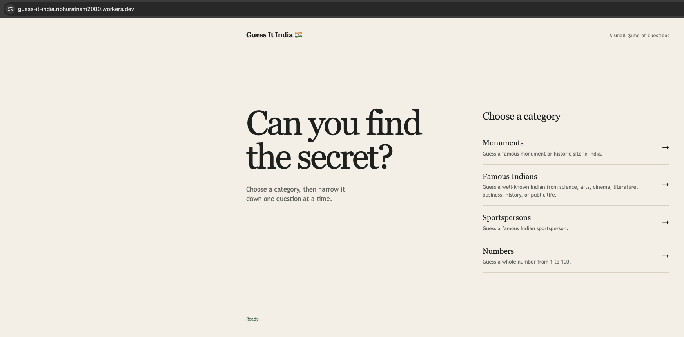
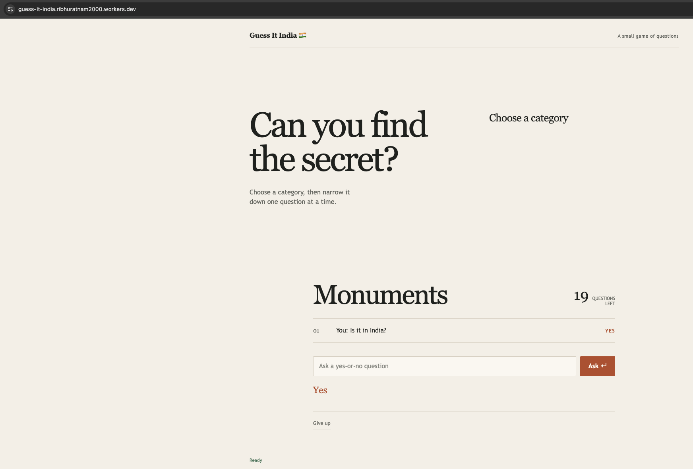
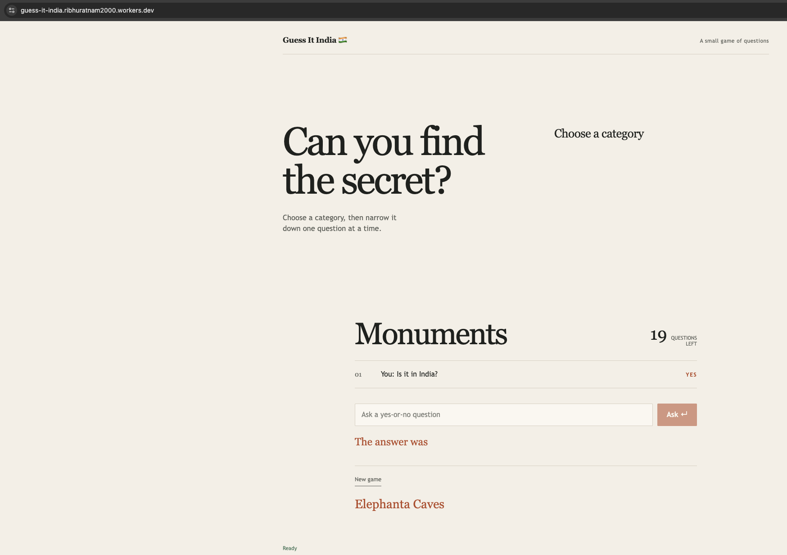

# Guess It India

Guess It India is a small, anonymous 20 Questions game about Indian monuments, famous Indians, sportspersons, and numbers. It is a vanilla HTML/CSS/JavaScript frontend served by the same Cloudflare Worker that exposes the game API.

## Screenshots

The public demo was deployed to Cloudflare Workers for testing and has since been taken offline. The screenshots below show the deployed application.

### Choose a category



### Ask your way to the answer



### Reveal the answer



## Architecture

- Cloudflare Worker: routes API requests and serves the frontend through Static Assets.
- SQLite-backed Durable Objects: one disposable `GameSession` owns each secret, question count, history, and game transition.
- Workers AI: judges arbitrary active-game questions with `@cf/meta/llama-3.3-70b-instruct-fp8-fast` and returns only YES, NO, or MAYBE.
- Deterministic game rules: exact guesses and supported number questions are handled without AI.

Game sessions are anonymous and disposable, with a 20-question limit. No authentication or personal data storage is used. Do not enter sensitive or personal information. Game questions may be sent to the language model for evaluation.

## Local development

Install dependencies and start Wrangler:

```sh
npm install
npm run dev
```

The local site is normally available at `http://localhost:8787`. Local Wrangler can recognize the Workers AI binding without running inference; Workers AI questions may require authenticated remote development or a deployed test environment.

## Checks

```sh
npm run typecheck
npx wrangler deploy --dry-run
git diff --check
```

## Deploy

```sh
npm run deploy
```

Review the Wrangler configuration and run the checks above before deploying.
